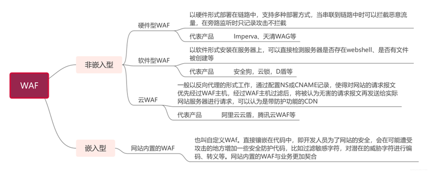
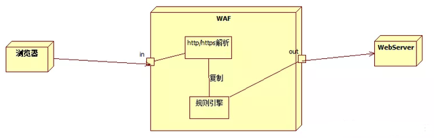
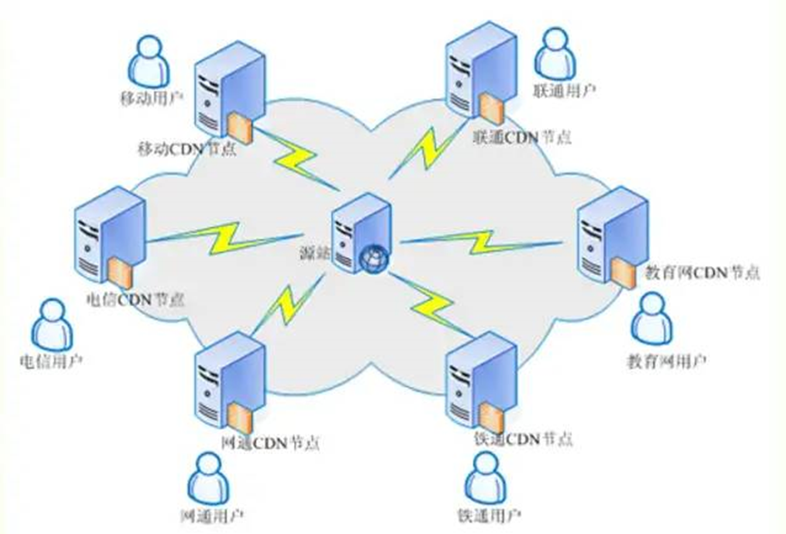
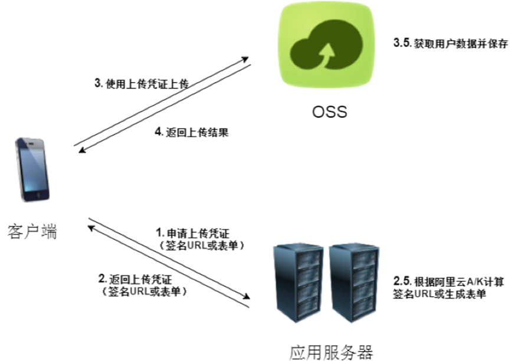
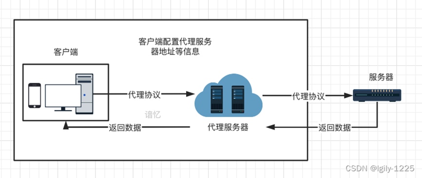
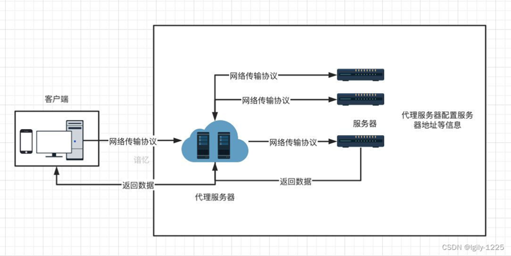

# 01-web 应用

## 基本 web 应用常识

### web 域名差异

🏠 主站（Primary Site）

主站是域名的根，直接以 baidu.com（或 www.baidu.com）访问的网站，是整个网站群的核心和入口。

baidu.com 本身就是百度主站，承载搜索、资讯等核心业务，权重最高，也是用户认知中最“正统”的那个站点。

🌐 分站 / 子站（Subdomain Site）

两者在技术上通常都指向二级域名（如 xxx.baidu.com），在日常语境中常被混用，但侧重点略有不同：

分站：更强调业务或地域的划分，如 map.baidu.com 是地图分站，tieba.baidu.com 是贴吧分站，各分站独立承载一条业务线。

子站：更强调层级关系，是挂在主域名下的一层站点，范围更宽泛，有时可指更深层级的子域名（如 123.blog.xiaodi8.com）。

以百度为例，map.baidu.com（百度地图）、fanyi.baidu.com（百度翻译）、wenku.baidu.com（百度文库）都是典型的子域名分站。它们与主站 baidu.com 是相对独立的，搜索引擎可能将其视为独立站点，在权重继承上不如目录站直接，但风险也相对隔离。

🚪 端口站（Port Site）

端口站是在同一个域名后面，通过不同的“端口号”来区分不同网站。端口号是紧跟在域名后面的数字（用冒号分隔）。

baidu.com 默认使用 443 端口（HTTPS）或 80 端口（HTTP），这些是默认端口，通常省略不写。而 baidu.com:8080 或 baidu.com:8888 这类形式，就是通过非默认端口访问到的另一个独立网站或服务。

端口站与主站共享同一个域名，但底层可能是完全不同的程序或应用。

📁 目录站（Directory Site）

目录站是在主域名后面加“路径（目录）”来形成的站点，形式为 baidu.com/目录名/。

baidu.com/help/（帮助中心）、baidu.com/about/（关于百度）都可视为目录站。它们本质上是主站下的一个子目录，通常与主站共享同一套服务器资源。

以百度自身的产品为例，baidu.com 下的很多频道页（如 /more/、/duty/）在技术上都属于目录站的形式。目录站的最大特点是紧密依附于主站：它继承主站的权重，主站排名好，目录页也可能受益；但反过来，如果目录站出了问题（如作弊被降权），也可能牵连主站。

实际上，分站和子站的域名都是子域名。

### 源码差异

源码目录结构对应

| 目录类型           | 常见目录/文件示例                                              | 说明                             |
| ------------------ | -------------------------------------------------------------- | -------------------------------- |
| 后台管理目录       | `admin`、`manage`、`system`、`backend`                         | 后台入口、管理模块、权限相关文件 |
| 前端资源目录       | `static`、`public`、`assets`、`templates`、`views`             | 静态资源、模板、视图文件         |
| 业务逻辑目录       | `app`、`application`、`module`、`src`、`controller`、`service` | 控制器、服务层、业务模块         |
| 数据相关目录       | `sql`、`data`、`db`、`migrations`、`seed`                      | 数据库脚本、迁移文件、初始化数据 |
| 配置目录           | `config`、`conf`、`env`、`.env`                                | 数据库配置、运行参数、环境变量   |
| 上传/缓存/日志目录 | `uploads`、`cache`、`logs`、`runtime`                          | 上传文件、缓存、运行日志         |
| 依赖与构建目录     | `vendor`、`node_modules`、`target`、`dist`、`build`            | 第三方依赖、编译产物、打包结果   |

原“文件目录”“逻辑目录”表述较泛，建议改为“前端资源目录”“业务逻辑目录”等明确分类。

源码开发语言类型

| 语言类型                | 常见后缀/说明                                  |
| ----------------------- | ---------------------------------------------- |
| ASP                     | `.asp`，早期动态网页技术，现已较少使用         |
| ASPX / ASP.NET          | `.aspx`、`.ascx`、`.cs`，属于 ASP.NET 技术体系 |
| PHP                     | `.php`                                         |
| Java                    | `.java`、`.jsp`、`.class`、`.jar`              |
| Python                  | `.py`                                          |
| Go                      | `.go`                                          |
| JavaScript / TypeScript | `.js`、`.ts`、`.jsx`、`.tsx`                   |
| C#                      | `.cs`，常与 ASP.NET 相关                       |

纠错：`Javascript` 规范写法为 `JavaScript`；`ASPX` 更准确表述为 `ASPX / ASP.NET`。

### 语言开发框架组件

| 语言/生态  | 常见框架/组件                                                          | 说明与纠错                                                                      |
| ---------- | ---------------------------------------------------------------------- | ------------------------------------------------------------------------------- |
| PHP        | ThinkPHP、Laravel、Yii、CodeIgniter、CakePHP、Zend Framework / Laminas | `Thinkphp` 应为 `ThinkPHP`                                                      |
| Java       | Spring、Spring Boot、MyBatis、Hibernate、Struts2                       | `JAVA` 应为 `Java`；`Springboot` 建议写作 `Spring Boot`                         |
| Python     | Django、Flask、Bottle、TurboGears、Tornado、web2py                     | `Turbobars` 应为 `TurboGears`；`Web2py` 建议写作 `web2py`                       |
| JavaScript | Vue.js、Angular、Node.js、Bootstrap、jQuery                            | `Node.js` 是运行时，不是前端框架；`Bootstrap`、`jQuery` 是库/组件，不宜统称框架 |

### 开源闭源加密类型

| 类型      | 特征                                           | 示例/说明                                 |
| --------- | ---------------------------------------------- | ----------------------------------------- |
| 开源      | 可获取源码，通常有 LICENSE、版权声明、公开仓库 | 如 Z-Blog、WordPress 等                   |
| 闭源      | 源码不公开，可能仅提供部署包或二进制           | 如内部开发系统、商业闭源软件              |
| 加密/混淆 | 源码经过加密、混淆、编译或授权保护             | 如通达 OA 等商业系统可能存在加密/授权机制 |
| 商业授权  | 有 License、授权文件、域名/用户数限制          | 需结合授权协议判断                        |
| 编译打包  | Java `.jar/.war`、Go 二进制、.NET 程序集等     | 源码不可直接阅读，但可反编译分析          |

纠错：`Zblog` 常见写法为 `Z-Blog`；`通达OA` 建议写作 `通达 OA`。开源、闭源、加密不是完全互斥维度，建议表述为“授权与源码可见性类型”。

### 识别方法与注意事项

1. 看目录：后台目录、配置目录、依赖目录、框架特征目录。
2. 看后缀：`.php`、`.java`、`.py`、`.go`、`.aspx`、`.js` 等。
3. 看依赖文件：`composer.json`、`package.json`、`pom.xml`、`requirements.txt`、`go.mod`。
4. 看框架特征文件：路由、控制器、模板、配置文件、入口文件。
5. 看授权与版权：`LICENSE`、`COPYRIGHT`、授权文件、加密文件、混淆代码。
6. 避免绝对化：目录名和框架特征只能作为初判依据，需结合多证据确认。

### 数据差异

**一、数据库类型分类**

数据库按数据模型分为两大类：关系型数据库与非关系型数据库。部署形态（本地、分离、云）是另一维度，与数据库类型不冲突。

**1. 关系型数据库（SQL）**

- 数据组织：以表格（行、列）存储，表间通过外键关联。
- 核心特点：固定模式、强一致性、支持复杂事务与多表关联查询。
- 适用场景：交易、财务、订单、库存等对一致性要求高的业务。
- 常见代表：MySQL、Oracle、SQL Server、PostgreSQL、DB2、Access。

**2. 非关系型数据库（NoSQL）**

- 数据组织：键值对、文档、列族、图等，不强制固定表结构。
- 核心特点：模式灵活、高并发读写、易横向扩展；多表关联与跨行事务较弱。
- 定位：关系型数据库的补充，而非简单替代。
- 常见代表：
  - Redis：键值型，内存为主，适合缓存、会话、分布式锁、排行榜。
  - MongoDB：文档型，类 JSON 存储，适合内容管理、用户档案、产品目录等模式多变场景。

**常见数据库归类速查**

| 数据库     | 分类                | 定位与特点                           |
| ---------- | ------------------- | ------------------------------------ |
| MySQL      | 关系型              | 开源、易用，Web 与 OLTP 主流         |
| Oracle     | 关系型              | 商业大型企业级，复杂事务与高可用     |
| SQL Server | 关系型              | 微软生态，企业级与商业智能           |
| PostgreSQL | 关系型（对象-关系） | 开源、高可扩展、高级数据类型丰富     |
| DB2        | 关系型              | IBM 企业级，大规模数据仓库与关键业务 |
| Access     | 关系型（桌面级）    | 轻量、界面友好，小型数据管理         |
| Redis      | 非关系型·键值       | 内存缓存，低延迟高并发               |
| MongoDB    | 非关系型·文档       | 半结构化数据，模式灵活               |

**二、三种部署形态**

**1. 本地数据库**

- 定义：数据库与应用部署在同一台或同一本地服务器环境。
- 特点：访问链路短、可控性强；服务器、备份、容灾、补丁、日常运维需自行承担。
- 适用：数据敏感、网络环境固定、初期成本敏感的场景。

**2. 分离数据库**

- 定义：数据库单独部署在另一台服务器，与应用分层。
- 特点：资源隔离、权限划分清晰、便于扩展；存在跨服务器网络时延，需处理连接配置、数据同步、备份策略与故障切换。
- 注意：运维复杂度与数据一致性要求高于本地部署。

**3. 云数据库**

- 定义：由云厂商托管交付的数据库服务，如 RDS。
- 特点：免底层运维、弹性伸缩、按需计费、自带高可用与备份能力。
- 适用：业务波动明显、希望快速部署、降低运维压力的场景。

**部署形态对比**

| 维度     | 本地数据库           | 分离数据库               | 云数据库                   |
| -------- | -------------------- | ------------------------ | -------------------------- |
| 运维责任 | 全部自担             | 部分自担，网络与同步复杂 | 厂商托管为主               |
| 访问延迟 | 低                   | 受网络影响               | 受网络与区域影响           |
| 扩展能力 | 受硬件限制           | 可独立扩展               | 弹性扩缩容                 |
| 成本结构 | 硬件与人力           | 硬件与人力增加           | 服务费+潜在流量/附加费     |
| 适用场景 | 固定小规模、敏感数据 | 应用与数据分层、资源隔离 | 波动业务、快速上线、降运维 |

**三、云数据库介绍**

云数据库不是新的数据模型，而是数据库的托管交付形态。以 RDS（Relational Database Service）为代表，云厂商将 MySQL、SQL Server、PostgreSQL 等引擎托管在云端，用户通过控制台或 API 获得具备容灾、备份、监控能力的数据库实例。

**核心能力**

- 免运维：预调配、配置、备份、补丁由平台接管，数分钟可创建实例。
- 高可用：主流 RDS 标配主备容灾与自动故障切换，可用性可达 99.99%，RTO 通常在数十秒内。
- 弹性伸缩：CPU、内存可秒级扩缩容；Serverless 形态按负载自动启停，计费粒度可细至 1 秒。
- 备份恢复：自动备份、时间点恢复、监控告警集成。

**主流产品侧重点**

- 阿里云 RDS：生态完善、文档丰富，国内电商与互联网覆盖广。
- 腾讯云 CDB/TDSQL：社交、游戏、微信生态场景优化。
- 华为云 GaussDB：金融级安全与信创合规。
- AWS RDS（含 Aurora）：全球化部署与跨区域容灾优势。

**成本注意**

- 内网互通通常免费；跨可用区或公网访问可能产生流量费。
- 免费备份周期之外的存储、高级监控、慢查询分析等可能额外付费。
- 选型应做总拥有成本（TCO）评估：运维人力节省 vs 潜在附加费用。

**四、数据差异关注点**

不同部署形态的数据差异主要体现在：

- 访问延迟与网络链路
- 数据同步机制与一致性
- 备份恢复的 RPO/RTO
- 权限与审计边界
- 版本补丁与升级节奏
- 扩展能力与成本结构

### 平台差异

1、系统：Windows、Linux、MacOS 等

2、容器：Docker、K8s、Vmware、VirtualBox 等

3、中间件：Apache、Nginx、IIS、lighttpd、Tomcat、Jboos、Weblogic、Websphere、Jetty 等

### 解析差异

1、URL 路由：URL 访问对应文件，MVC 模型等

2、相对绝对：相对当前目录，完整的目录路径

3、格式权限：后门解析格式，代码正常执行，脚本执行权限等

## 常见的 web 架构

1、套用模版型

csdn / cnblog / github / 建站系统等

安全测试思路上的不同：

一般以模版套用，基本模版无漏洞，大部分都采用测试用户管理权限为主

2、前后端分离

例子：https://www.rxthink.cn/

思路：https://mp.weixin.qq.com/s/HtLU_EBXWcbq-lt10oPYwA

安全测试思路上的不同：前端以 JS（Vue,NodeJS 等）安全问题，主要以 API 接口测试，前端漏洞（如 XSS）为主，后端隐蔽难度加大。

3、集成软件包

宝塔，Phpstudy，xamp 等

安全测试思路上的不同：主要是防护体系，权限差异为主

4、自主环境镜像

云镜像打包，自行一个个搭建

安全测试思路上的不同：主要是防护体系，权限差异为主

5、容器拉取镜像

Docker

安全测试思路上的不同：虚拟化技术，在后期测试要进程逃逸提权

6、纯静态页面

纯 HTML+CSS+JS 的设计

安全测试思路上的不同：无后期讲到的 Web 漏洞

找线索：找资产，域名，客户端等

## web 源码形式

MVC 框架：一种把应用拆成模型（Model，管数据与业务逻辑）、视图（View，管界面展示）和控制器（Controller，接收请求并协调二者）的分层架构模式，核心是实现关注点分离。后端框架（Spring MVC、Django、Rails、ASP.NET Core、Laravel）是 MVC 的典型落地。

旨在了解源码差异，后期代码审计和测试中对源码真实性的判断

1、单纯简易源码

2、MVC 框架源码

3、编译调用源码

如：NET-DLL 封装 Java-Jar 打包

4、前后端分离源码

https://segmentfault.com/a/1190000045026063

5、加密型源码

## web+WAF

WAF,Web application firewall，web 应用防火墙，专门为 web 应用程序提供安全防护的安全工具或者服务。

WAF 主要工作在应用层。常见的网络防火墙主要工作在网络层和传输层，基于 IP 端口和协议来过滤流量

常见的 web 安全测试手段都会被 WAF 拦截。





案例：ubuntu20.04 安装雷池 WAF 社区版

安装雷池：

https://docs.waf-ce.chaitin.cn/

```bash
bash -c "$(curl -fsSLk https://waf-ce.chaitin.cn/release/latest/setup.sh)"
```

搭建网站：

https://zhuanlan.zhihu.com/p/705196831

```shell
docker run --name webgoat -d -p 8080:8080 -p 9090:9090 registry.cn-shanghai.aliyuncs.com/kubesec/webgoat:v2023.8
```

配置雷池：

添加站点-设置域名-上游地址-没真实域名修改本地 host 解析

## web+CDN



CDN 就是把内容放到离用户更近的服务器上，让用户就近取，不用每次都回源站。

如果没有 CDN，那就是每次交互都是 用户<-->服务器

如果相隔比较远，那么响应会非常慢。

常见的名词:

源站：内容的总仓库。

边缘节点：离用户最近的缓存服务器。

回源：边缘节点没有缓存时，回源站取内容。

缓存命中率：命中越高，回源越少，越快越省源站压力。

TTL：缓存多久过期。

一次访问分三步：

调度：DNS 把用户引导到最近、最合适的边缘节点。

缓存响应：节点有缓存就直接返回；没有就向上层或源站回源。

回源并缓存：取回内容后返回给用户，同时存一份，下次更快。

所以 CDN 的价值不只是“快”，还能减轻源站压力、提升稳定性、抵御部分攻击。

## web+OSS



OSS:object storage service,对象存储服务。国内做的比较好的就是阿里云的 OSS，国内其他云厂商几乎没有此功能。

云存储服务，成本比本地加一块磁盘要低很多。静态文件在服务器中会占据大量的带宽，使用 OSS 可以有效降低服务器的负载。

如果使用 OSS 存储上传的文件，可以有效避免文件上传解析漏洞，就算是上传了一个木马文件，不解析，就没法起作用。但是会存在 AK/SK 隐患。

## web+反向代理

正代理为客户端服务,客户端主动建立代理访问目标（不代理不可达）

反向代理为服务端服务,服务端主动转发数据给可访问地址（不主动不可达）

原理：通过网络反向代理转发真实服务达到访问目的

影响：访问目标只是一个代理，非真实应用服务器

注意：正向代理和反向代理都是解决访问不可达的问题，但由于反向代理中多出一个可以重定向解析的功能操作，导致反代理出的站点指向和真实应用毫无关系！





## web+负载均衡

原理：分摊到多个操作单元上进行执行，共同完成工作任务

影响：有多个服务器加载服务，测试过程中存在多个目标情况

演示：Nginx 负载均衡配置

Windows2016 + BT 宝塔面板 + Nginx

定义负载设置

```nginx
upstream fzjh{
	server 120.26.70.72:80 weight=1;
	server 47.75.212.155:80 weight=2;
}

#定义访问路径 访问策略
location / {
    proxy_pass http://fzjh/;
}

```

## 蜜罐

蜜罐：（Honeypot）简单说就是：一个故意伪装成“有价值、有漏洞、可攻击”的系统或服务，用来引诱攻击者上钩，并在他们探测、攻击的过程中记录行为、发出告警、收集情报的安全诱饵。

Hfish 则是一种中低交互的蜜罐系统。渗透测试人员入侵到业务系统时实际上是进入到整个蜜罐系统。

Ubuntu20.04 安装 Hfish。

```bash
bash <(curl -sS -L https://hfish.net/webinstall.sh)
```

## 堡垒机

跳板机：一台可以从外网访问、再由此登录内网其他服务器的“中转主机”。

堡垒机：在跳板机基础上发展出来的运维安全管控平台。它仍然是统一入口，但核心不只是“能跳进去”，而是把 认证、授权、账号管理、审计 做成闭环。

Ubuntu20.04 部署堡垒机

```bash
curl -sSL https://resource.fit2cloud.com/jumpserver/jumpserver/releases/latest/download/quick_start.sh | bash
```

## API 接口

API 接口是一个允许不同软件应用程序之间进行通信和数据交换的接口。API 定义了一组规则和协议，软件开发者可以使用这些规则和协议来访问操作系统、库、服务或其他应用程序的功能。

1、Web API:

通过 HTTP 协议进行通信的 API，常用于 Web 服务和应用程序。

例如，RESTful API、GraphQL API。

2、库和框架 API:

提供特定编程语言或框架功能的 API，供开发者在应用程序中使用。

例如，Java API、Python 标准库。

3、操作系统 API:

提供操作系统功能访问的 API。

例如，Windows API、POSIX API。

4、远程 API:

允许在网络上远程访问服务的 API。

例如，SOAP API、XML-RPC API。
