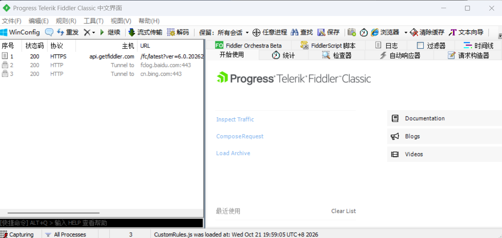

# 抓包技术

### 准备工作

抓包技术简单来讲就是抓取数据包。
1、浏览器安装证书：解决本地抓 HTTPS
2、模拟器安装证书：解决模拟器抓 HTTPS
3、真机器安装证书：解决真机器抓 HTTPS
(抓包技术其实还有一种就是 wireshark 之类的，直接抓 tcp 协议包)
常见的抓包工具
Fiddler：
https://www.telerik.com/fiddler
是一个 http 协议调试代理工具，它能够记录并检查所有你的电脑和互联网之间的 http 通讯，设置断点，查看所有的“进出”Fiddler 的数据（指 cookie,html,js,css 等文件）。 Fiddler 要比其他的网络调试器要更加简单，因为它不仅仅暴露 http 通讯还提供了一个用户友好的格式。

Charles：
https://www.charlesproxy.com/
是一个 HTTP 代理服务器,HTTP 监视器,反转代理服务器，当浏览器连接 Charles 的代理访问互联网时，Charles 可以监控浏览器发送和接收的所有数据。它允许一个开发者查看所有连接互联网的 HTTP 通信，这些包括 request, response 和 HTTP headers （包含 cookies 与 caching 信息）。

BurpSuite：
是用于攻击 web 应用程序的集成平台，包含了许多工具。Burp Suite 为这些工具设计了许多接口，以加快攻击应用程序的过程。所有工具都共享一个请求，并能处理对应的 HTTP 消息、持久性、认证、代理、日志、警报。

Reqable：
https://reqable.com/
是一款跨平台的专业 HTTP 开发和调试工具，在全平台支持 HTTP1、HTTP2 和 HTTP3(QUIC)协议，简单易用、功能强大、性能高效，助力程序开发和测试人员提高生产力！说白了，他就是抓包工具 + Postman 的合体，既可以抓包，又可以测试接口。

Yakit:
https://www.yaklang.com
Yakit 是一个基于 Yak 语言的安全领域垂直语言工具，它提供了一个图形化用户界面（GUI）来操控 Yak 引擎的能力。Yakit 旨在降低使用安全工具的门槛，使得安全从业者即使没有编程技能也能轻松地进行安全测试和分析。

Wireshark：
https://www.wireshark.org/
网络封包分析软件。网络封包分析软件的功能是截取网络封包，并尽可能显示出最为详细的网络封包资料。Wireshark 使用 WinPCAP 作为接口，直接与网卡进行数据报文交换。

科来网络分析系统：
https://www.colasoft.com.cn/
该系统具有行业领先的专家分析技术，通过捕获并分析网络中传输的底层数据包，对网络故障、网络安全以及网络性能进行全面分析，从而快速排查网络中出现或潜在的故障、安全及性能问题。

### Fiddler 使用

##### fiddler 介绍

Fiddler 是由 Telerik 开发的一款免费网络调试工具，可通过代理方式拦截所有 HTTP/HTTPS 流量，用于请求分析、接口调试和性能优化。

与其他抓包工具相比，Fiddler 拥有更高的灵活性和可扩展性：

支持多端抓包：可分析浏览器、App、小程序、桌面应用请求；
支持 HTTPS 解密：能读取加密请求内容；
可设置断点修改请求：实现灵活的请求模拟；
内置 Mock 功能：可返回自定义本地数据；
性能分析工具：统计请求耗时与服务器响应速度。
注意 classic 目前可以给非商业使用，并且此版本不在进行维护更新。everywhere 版是商业版本。也是目前官方投入和支持的版本。
主要针对 fiddler everywhere 版。

##### fiddler 安装

安装好之后，默认会接管系统代理。
启动很简单，双击快捷方式即可启动，抓取本地的 http 包几乎可以不用配置。
打开浏览器访问网站，会自动看到请求在左侧的请求列表中

